# 社區活動報名模板

給社區、青創戶與社宅團隊使用的活動報名網站。住戶在手機上就能看活動、報名、加入行事曆；主辦方在後台建活動、管名單、現場報到、看統計。網站架在 Cloudflare 上，一般社區的用量通常落在免費額度內。

[](https://deploy.workers.cloudflare.com/?url=https://github.com/dwhao84/community-events-template)

## 可以做什麼

**住戶端**

- 活動列表：日期、時間、地點、剩餘名額，以及「免費／收費／待定」標示。
- 線上報名：可一次替家人報名；報名表會依人數算出應繳金額（本網站不收款，繳費方式由主辦方說明）。
- 加入行事曆：iPhone／Outlook（.ics）或 Google 日曆，在活動卡片、報名成功頁和通知信都有。
- 首頁輪播 Banner、「關於我們」頁、防詐知識頁。

**主辦方後台**

- 新增活動精靈：一次填好活動、第一個場次、收費與報名表，按一下就開放報名。
- 活動可以複製、隱藏（暫時不公開，已報名的人不受影響）、刪除（可復原）。
- 報名名單：確認、候補、取消；可手動新增電話或紙本報名的人，也可永久刪除已取消的報名資料。
- 名額依「參加人數」計算，可設定每筆最多幾人，額滿自動候補；資料庫層會再檢查一次，不會超收。
- 現場報到、手寫簽名、可列印的簽到單。
- 活動統計：報名、確認、候補與實際出席人次，可依年份篩選並匯出 CSV。
- 網站外觀：10 組預設配色（海洋藍、森林綠、湖水青、暖陽橘、櫻花粉、薰衣草紫、磚紅、大地棕、夜空藍、沉穩灰），也可以自訂五個顏色，有即時預覽與文字對比檢查；可上傳網站圖示（瀏覽器分頁與手機主畫面）。
- 首頁 Banner 管理：上傳、排序、上架／下架、設定期間、刪除。
- 「關於我們」頁編輯器：主標題、文字、卡片（2／3／4 欄）、圖文並排、連結、聯絡資訊等區塊，可自由排序並調整底色與對齊。
- Email 通知（選用）：收件、確認、行前提醒、取消；課程回饋問卷。
- 權限分模組：活動、報名、報到、照片、通知、匯出、回饋、管理員。

## 網站配色

內建 10 組配色，主辦方可以在後台「網站外觀」隨時切換，也可以自訂五個顏色。標題、按鈕、標籤與卡片底色都會一起改變；所有預設配色都通過文字對比檢查（按鈕與標題 4.5:1、內文 7:1 以上）。下面是各配色的活動列表畫面。

### 電腦版

<table>
<tr>
<td align="center" width="50%">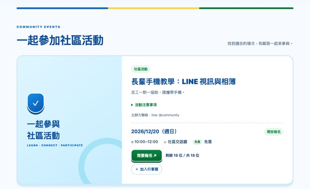<br><b>海洋藍</b> <code>ocean</code>（預設）</td>
<td align="center" width="50%">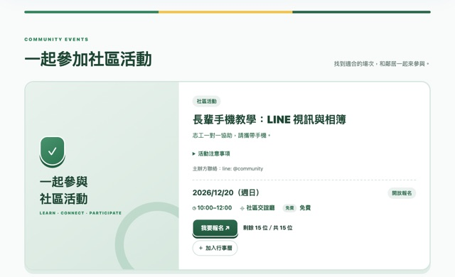<br><b>森林綠</b> <code>forest</code></td>
</tr>
<tr>
<td align="center" width="50%">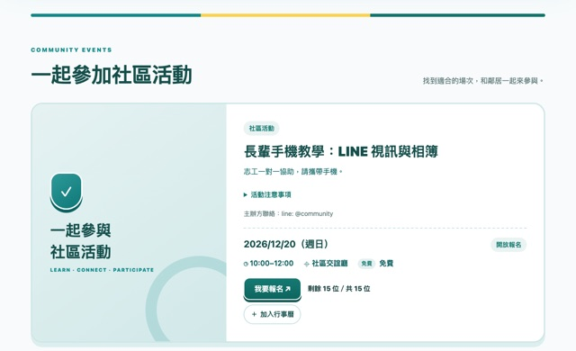<br><b>湖水青</b> <code>teal</code></td>
<td align="center" width="50%">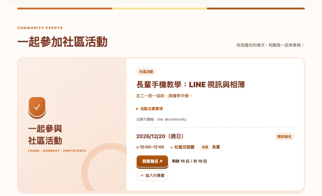<br><b>暖陽橘</b> <code>sunset</code></td>
</tr>
<tr>
<td align="center" width="50%">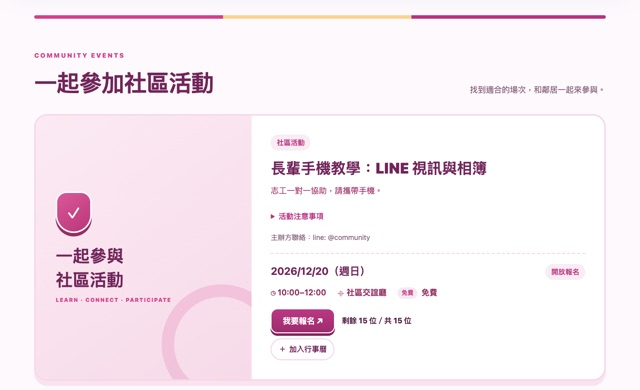<br><b>櫻花粉</b> <code>sakura</code></td>
<td align="center" width="50%">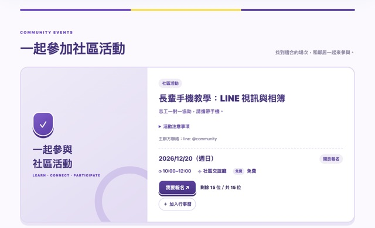<br><b>薰衣草紫</b> <code>lavender</code></td>
</tr>
<tr>
<td align="center" width="50%">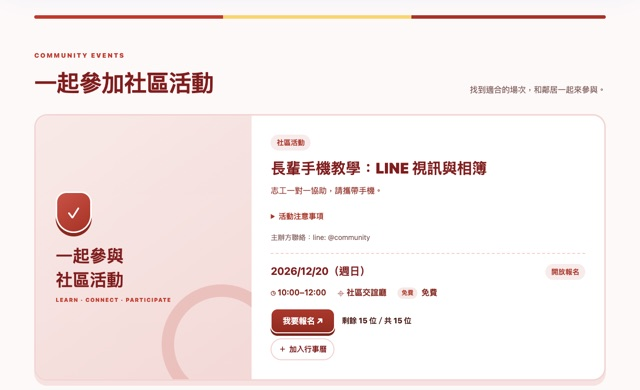<br><b>磚紅</b> <code>brick</code></td>
<td align="center" width="50%">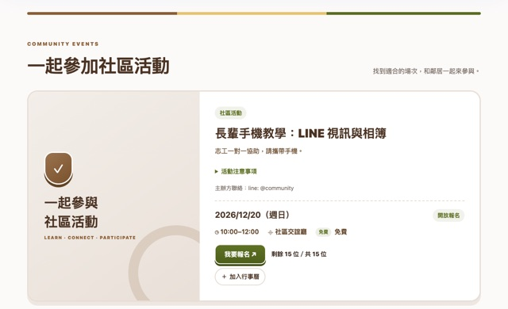<br><b>大地棕</b> <code>earth</code></td>
</tr>
<tr>
<td align="center" width="50%">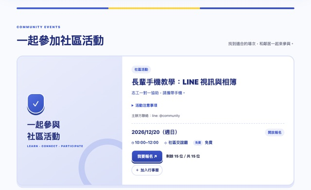<br><b>夜空藍</b> <code>night</code></td>
<td align="center" width="50%">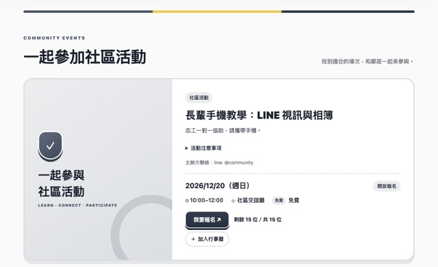<br><b>沉穩灰</b> <code>graphite</code></td>
</tr>
</table>

### 手機版

<table>
<tr>
<td align="center" width="20%">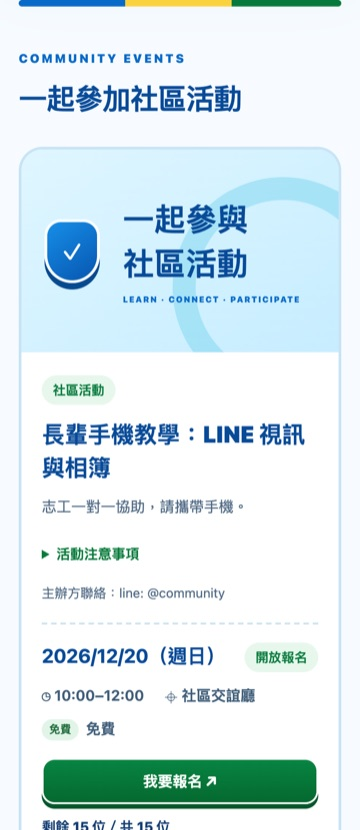<br><b>海洋藍</b></td>
<td align="center" width="20%">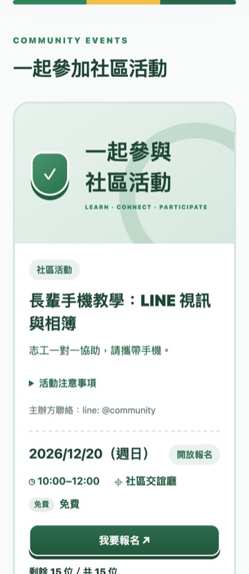<br><b>森林綠</b></td>
<td align="center" width="20%">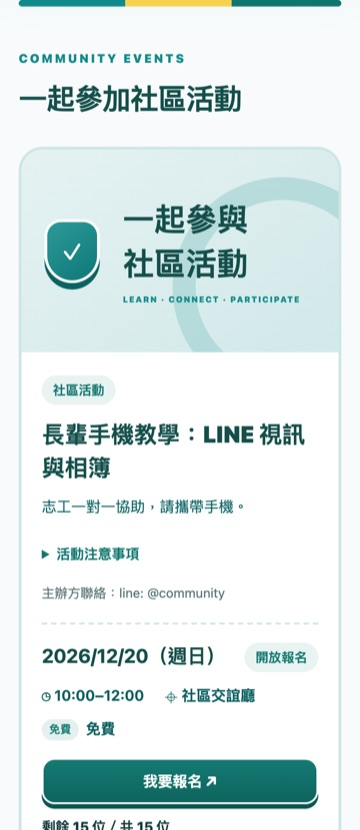<br><b>湖水青</b></td>
<td align="center" width="20%">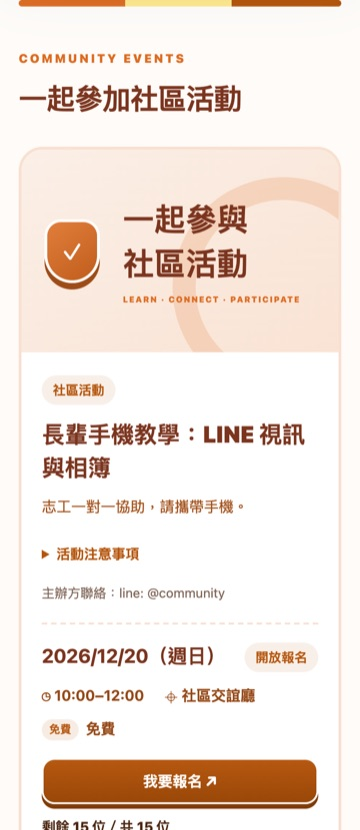<br><b>暖陽橘</b></td>
<td align="center" width="20%">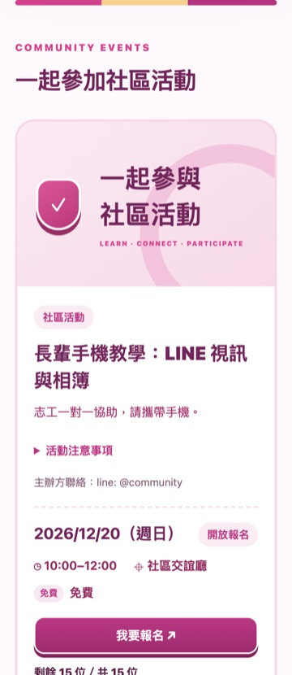<br><b>櫻花粉</b></td>
</tr>
<tr>
<td align="center" width="20%">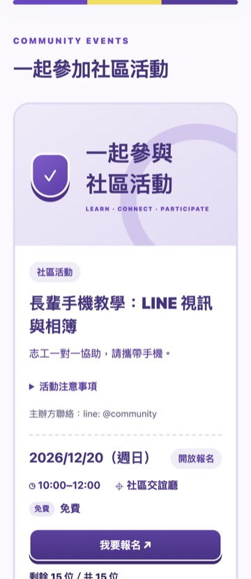<br><b>薰衣草紫</b></td>
<td align="center" width="20%">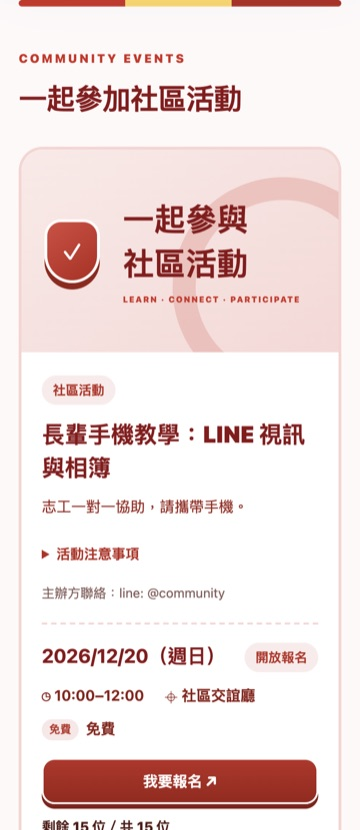<br><b>磚紅</b></td>
<td align="center" width="20%">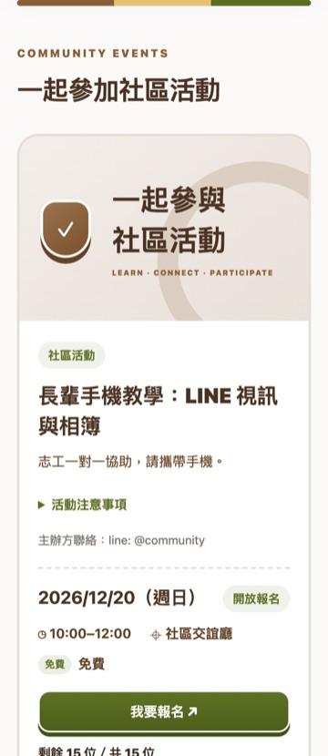<br><b>大地棕</b></td>
<td align="center" width="20%">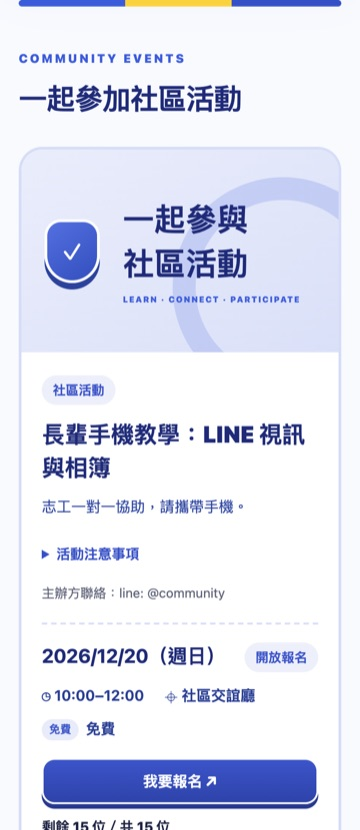<br><b>夜空藍</b></td>
<td align="center" width="20%">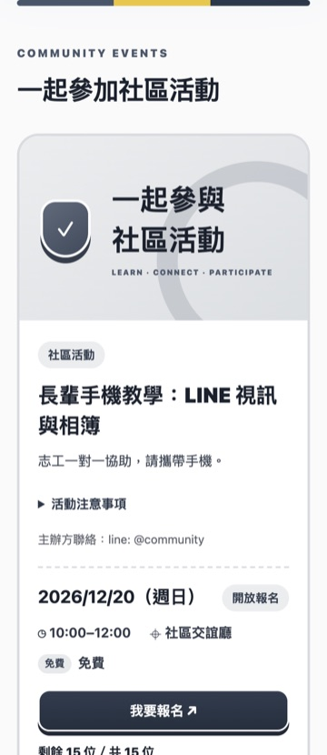<br><b>沉穩灰</b></td>
</tr>
</table>

- 開站前想先指定預設配色：把 `site.config.json` 的 `theme` 改成上表的英文代號（例如 `"theme": "forest"`）。在後台存過配色之後，以後台的設定為準。
- 首頁主視覺與 Banner 是圖片，不會跟著配色改變。
- 截圖使用本機的示範資料。手機版截圖寬度為 390px，並隱藏了右下角的「社區小幫手」按鈕，以免擋住畫面。

## 開始使用

需要準備：
- **Cloudflare 帳號**（免費）。第一次啟用 R2 圖片儲存時，Cloudflare 可能要求綁定付款方式，免費額度內不會收費。
- **GitHub 帳號**。
- 選用：Resend 帳號與一個網域，用來寄 Email 通知。

全部用免費方案就能運作，見下方「費用」。

- 想自己一步步照著做：看 [`docs/setup-guide.md`](docs/setup-guide.md)（每一步的指令與預期結果）。
- 想知道哪些事一定要自己動手（登入帳號、輸入秘密、後台設定）：看 [`docs/manual-handoffs.md`](docs/manual-handoffs.md)。

### 方法一：交給 AI 助理（建議）

用 Claude Code、Codex 或 Gemini CLI 開啟這個資料夾：

1. 填好 [`MY-COMMUNITY.md`](MY-COMMUNITY.md)（社區名稱、管理員 Email、身分選項……）。
2. 對 AI 說：

   > 請依 community-setup skill，讀取 MY-COMMUNITY.md，幫我把這個模板設定好並部署。

AI 會依 [`.agents/skills/community-setup/SKILL.md`](.agents/skills/community-setup/SKILL.md) 的步驟操作：填設定、在你的電腦上預覽、部署、設定後台登入，最後帶你完成開站檢查。每次要部署或建立雲端資源之前，AI 都會先問你。

- Claude Code 讀 `CLAUDE.md`，Codex 讀 `AGENTS.md`，Gemini CLI 讀 `GEMINI.md`，三者內容相同。
- skill 同時放在 `.claude/skills/` 與 `.agents/skills/`。

### 方法二：Deploy to Cloudflare 按鈕

1. 按上方按鈕，依畫面登入 Cloudflare 與 GitHub。Cloudflare 會：
   - 把程式複製到你的 GitHub；
   - 建立資料庫（D1）與圖片儲存（R2）；
   - 請你填入秘密值，並完成部署。
2. 秘密欄位：
   - `RATE_SALT`、`FEEDBACK_TOKEN_SECRET`：各填一串 32 字以上的隨機文字。
   - `ADMIN_BOOTSTRAP_EMAIL`：第一位管理員的 Email。
   - `RESEND_*`：沒有要寄信可以留空。
3. 部署完成後，在你自己的 repo：
   - 修改 `site.config.json`，換成你的社區名稱、標語、連結與身分選項；
   - 在 `wrangler.jsonc` 填入 `SITE_URL`（剛拿到的網址）。

   push 後會自動重新部署。
4. 繼續下面的「設定後台登入」。

### 設定後台登入（兩種方法都需要）

後台用 Cloudflare Access 保護。只有你指定的 Email 能進入，登入時會寄驗證碼到信箱。

1. Cloudflare 儀表板 → Zero Trust → Access → Applications → Add an application → Self-hosted。
2. 網域填你的網站網址，保護兩個路徑：`admin` 和 `api/admin`。
3. Policy 選 Allow，Include → Emails，填管理員 Email。
4. 複製兩個值，填入 `wrangler.jsonc` 後重新部署：
   - Application Audience (AUD) Tag → `ACCESS_AUD`
   - 團隊網域 `<團隊>.cloudflareaccess.com` → `ACCESS_TEAM_DOMAIN`
5. 用 `ADMIN_BOOTSTRAP_EMAIL` 那個信箱開啟 `/admin/`，第一次登入會自動成為管理員。

若 `workers.dev` 網址無法設定路徑型 Access，請改用交給 Cloudflare 管理的自訂網域。

### 防止機器人灌報名：Cloudflare Turnstile（強烈建議）

報名不需登入，如果不開這項防護，有人可以用程式大量送出假報名把名額佔滿，或借你的網站寄「報名收件通知」給陌生人。Turnstile 是 Cloudflare 的免費真人驗證，多數住戶只會看到一個自動打勾的小方框。

1. Cloudflare 儀表板 → **Turnstile** → **Add widget**。
   - 主機名稱填網站網域（例如 `events.example.org`；用 `workers.dev` 就填那個網址的網域）。
   - Widget Mode 選 **Managed**。
2. 複製兩個值：
   - **Site Key**（公開）→ 填入 `wrangler.jsonc` 的 `TURNSTILE_SITE_KEY`。
   - **Secret Key**（秘密）→ `npx wrangler secret put TURNSTILE_SECRET_KEY`。用 Deploy 按鈕部署的話，在 Worker 的 Settings → Variables and Secrets 新增。
3. 重新部署後打開報名表，送出按鈕上方會出現驗證方框。

兩個值要一起設定；只設一個時，報名會暫停並顯示「報名防護設定不完整」，避免以為有防護其實沒有。之後如果 Cloudflare 的驗證服務暫時連不上，報名也會請住戶稍後再試。

### 開站前，在後台完成

1. **營運設定**：寫正式的個資告知，換新版本號，勾選「可允許場次開放報名」。
2. **關於我們頁面**：介紹你的社區。
3. **網站外觀**：選配色、上傳網站圖示。
4. **活動與場次 → ＋ 新增活動**：建立第一個活動。
5. **首頁 Banner**：上傳活動海報（建議 1920×640 或 1920×1080），並連到活動。

## 使用說明

後台網址是 `<你的網站>/admin/`，用管理員 Email 收驗證碼登入。左側選單每一項對應下面一節。

### 辦一場活動的流程

1. **建立活動**：到「活動與場次」，按「＋ 新增活動」，跟著精靈填三步：
   - 活動資料：名稱、說明、注意事項、聯絡方式、封面。
   - 第一個場次：日期、時間、地點、名額、每筆最多幾人，以及收費（免費／收費＋金額／待定）。
   - 報名表：用內建標準表（姓名、Email、電話、人數），或自己加欄位。

   按「建立並開放報名」，活動就會出現在首頁。
2. **宣傳**：到「首頁 Banner」上傳海報，連到這個活動，並設定上架與下架時間。
3. **收報名**：住戶在首頁報名後，名單出現在「報名名單」。
   - 「確認名額」：通知對方已確認。
   - 「改為候補」：名額不夠時使用。額滿後的報名也會自動列入候補。
   - 「取消報名」：釋出名額。
   - 電話或紙本報名的人：按「＋ 新增報名者」手動登記，可以選擇要不要寄通知。
4. **活動當天**：到「現場報到」。
   - 搜尋姓名勾選報到、請參加者簽名。
   - 臨時來的人用「現場直接報名」。
   - 要紙本可按「活動簽到表／列印」。
5. **活動後**：
   - 「活動照片」：上傳照片，填好說明後再發布。
   - 「課程回饋」：建立回饋表，寄問卷給出席者。
   - 「活動統計」：看報名、確認、候補和實際出席人次，可以匯出 CSV 寫成果報告。

### 常用操作

| 想做的事 | 怎麼做 |
| --- | --- |
| 同一個活動再加一個場次 | 活動與場次 → 編輯活動 → 新增場次 |
| 下個月再辦一次 | 活動卡片按「複製」，再改日期 |
| 先不要讓住戶看到某個活動 | 按「隱藏」。已報名的人不受影響，可隨時取消隱藏 |
| 活動停辦 | 先把活動狀態改成「取消」，系統會停止提醒信；不要直接刪除 |
| 刪掉建錯的活動 | 按「刪除」並輸入活動名稱確認。還有有效報名時不能刪；刪錯可在「已刪除的活動」復原 |
| 刪除某人的個資 | 先「取消報名」，再按「永久刪除個資」，刪了無法復原 |
| 改報名表的欄位 | 報名表一旦發布就不能修改，要「從目前版本建立草稿」→ 修改 →「發布此版本」 |
| 換網站顏色或圖示 | 網站外觀：選配色或自訂顏色，預覽確認後儲存；也可上傳網站圖示 |
| 改「關於我們」頁 | 關於我們頁面：新增區塊、排序，調整底色與對齊 |
| 加一位管理員 | 見下方「新增其他管理員」 |
| 確認 Email 有沒有寄出 | 通知中心：查看寄送紀錄，也可「寄測試信」給自己 |

### 新增其他管理員

目前後台沒有新增管理員的畫面，要做兩件事：

1. **Cloudflare Access**：Zero Trust → Access → Applications → 你的應用程式 → Policy，在 Emails 加上他的 Email，讓他能登入。
2. **授權模組**：在專案資料夾執行下面的指令（或請 AI 助理代勞），把 Email 換成他的，只留要給的模組：

   ```sh
   npx wrangler d1 execute DB --remote --command "INSERT INTO admin_permissions VALUES ('helper@example.org','events'),('helper@example.org','registrations'),('helper@example.org','checkin')"
   ```

模組名稱：

| 模組 | 對應功能 |
| --- | --- |
| `events` | 活動與場次、統計、關於我們 |
| `registrations` | 報名名單 |
| `checkin` | 現場報到 |
| `photos` | 活動照片、首頁 Banner |
| `notifications` | 通知中心 |
| `export` | 匯出 CSV |
| `feedback` | 課程回饋 |
| `admins` | 營運設定、網站外觀 |

只負責活動當天報到的志工，給 `checkin` 就好。

### 住戶端

- 首頁會列出開放中的活動，顯示日期、地點、剩餘名額和費用。
- 按「報名」填表。可以一次替家人報名，表單會自動算出應繳金額。網站本身不收款，繳費方式由主辦方在活動說明中寫清楚。
- 報名成功頁與通知信都有「加入行事曆」，可加到 iPhone、Outlook 或 Google 日曆。

## 費用

**結論：一般社區每月 0 元。** 只有要寄 Email 時，需要買一個網域（每年約 NT$350 起）。

### 費用表

匯率以 1 美元 ≈ 32 新台幣估算。

| 服務 | 用途 | 免費額度 | 超過後的價格 | 一般社區會超過嗎 |
| --- | --- | --- | --- | --- |
| Cloudflare Workers | 網站本體、API、寄信排程 | 每天 10 萬次請求 | Workers Paid 每月 US$5（約 NT$160）起，含每月 1,000 萬次請求 | 不會。每天要上萬人造訪才會接近 |
| Cloudflare D1 | 資料庫：活動、報名、名單 | 5 GB；每天讀 500 萬列、寫 10 萬列 | 隨 Workers Paid 方案 | 不會 |
| Cloudflare R2 | 圖片：Banner、封面、照片、圖示 | 每月 10 GB 儲存、100 萬次寫入、1,000 萬次讀取；下載流量免費 | 儲存每 GB 每月 US$0.015（約 NT$0.5） | 不會。1 MB 的照片可以放約 1 萬張 |
| Cloudflare Zero Trust | 後台登入驗證 | 50 位使用者 | 付費方案 | 不會 |
| GitHub | 放程式、自動部署 | 免費 | — | — |
| Resend（選用） | 寄 Email 通知 | 每月 3,000 封、**每天 100 封**、3 個網域 | Pro 每月 US$20（約 NT$640），每月 5 萬封，沒有每日上限 | **大活動可能會**，見下方 |
| 網域（選用，寄信必備） | 例如 `events.example.org` | — | .com／.org 每年約 US$11–12（約 NT$350–400）；在 Cloudflare 買是原價 | 一次性年費 |
| Google Analytics 4（選用） | 流量統計 | 免費 | — | — |

### 依規模估算

| 情境 | 規模 | 每月 | 每年 |
| --- | --- | --- | --- |
| 小型、不寄信 | 每月 4 場、每場 30 人 | 0 元 | 0 元 |
| 一般、要寄信 | 每月 8 場、每場 40 人，每月約 960 封信 | 0 元 | 網域約 NT$350–400 |
| 大型、要寄信 | 每月 20 場以上，或單場超過 30 人且集中在同一天報名 | Resend Pro 約 NT$640 | 約 NT$7,700＋網域 |

**為什麼大活動容易碰到每天 100 封的上限？** 每筆報名大約會寄 3 封信：收件、確認、行前提醒。一場 40 人的活動在同一天全部確認，確認信就有 40 封；再加上當天其他活動的提醒信，就可能超過 100 封。超過上限時，系統會自動重試幾次（約 2 小時內）。仍寄不出去的信，會在「通知中心」標成「結果不明」，需要等額度重置後再處理。每日額度以 UTC 計算，在台灣時間早上 8 點重置。活動多的社區建議直接用 Resend Pro，沒有每日上限。

### 注意事項

- 第一次啟用 R2 時，Cloudflare 會要求綁定信用卡。免費額度內不會扣款，建議到 Billing 開啟用量通知。
- 不寄 Email 也能正常使用網站：住戶在報名成功頁就能看到報名編號，也能加入行事曆。
- 價格查核日期為 2026 年 11 月，之後以官方頁面為準：[Workers](https://developers.cloudflare.com/workers/platform/pricing/)、[D1](https://developers.cloudflare.com/d1/platform/pricing/)、[R2](https://developers.cloudflare.com/r2/pricing/)、[Zero Trust](https://www.cloudflare.com/plans/zero-trust-services/)、[Resend](https://resend.com/pricing)、[Cloudflare 網域](https://domains.cloudflare.com/)。

## 圖片尺寸

格式用 JPG、PNG 或 WebP。iPhone 的 HEIC 請先轉成 JPG（設定 → 相機 → 格式 →「最相容」）。單張上限 8 MB、最長邊 6000 px，建議壓到 1 MB 以內。圖片一律依原比例完整顯示，不會被裁切。

| 位置 | 建議尺寸 | 在哪裡上傳 |
| --- | --- | --- |
| **首頁 Banner** | **1920 × 640（3:1）** 或 1920 × 1080（16:9） | 後台「首頁 Banner」 |
| 活動封面 | 1600 × 900（16:9） | 新增活動精靈或活動編輯 |
| 關於我們：圖文並排 | 1200 × 900（4:3） | 後台「關於我們頁面」 |
| 活動照片 | 最長邊 2000 px | 後台「照片」（自動產生 800 px 縮圖） |
| 網站圖示 | 正方形 512 × 512 以上 | 後台「網站外觀」 |

### Banner 製作重點

- **字要大**：手機上 Banner 只有約 350 px 寬，標題字高至少 80 px，一張放 2–3 行就好（活動名稱、日期、地點）。
- **重要內容不要貼邊**：四周各留約 5% 空白。
- **上傳後**：替代文字必填，寫出圖上的重點，例如「夏日市集，7/20（六）下午兩點，一樓中庭」；接著連到活動，並視需要設定上架與下架時間。
- 直式海報也能放，但會縮小置中，兩側留白。

### 用 AI 生成 Banner

AI 繪圖常把中文字畫錯。建議讓 AI **只畫背景、不放字**，再到 Canva 開 1920 × 640 的畫布，自己加上文字。

```
一張社區活動的橫式 Banner 背景插圖，比例 16:9。
主題：【夏日親子市集】，畫面有【攤位、氣球、小朋友和長輩在中庭逛市集】。
風格：【溫暖的扁平插畫】，配色以【#0769c8 藍色和 #ffd43b 黃色】為主，明亮、乾淨。
構圖：主體放在畫面右側，左側 40% 保留乾淨、顏色單純的留白區，之後要放文字。
畫面四周保留邊距，重要物件不要貼邊。
不要出現任何文字、字母、數字、Logo 或浮水印。
```

- 【】內換成你的活動；配色換成後台「網站外觀」選的主色。
- Midjourney 在最後加 `--ar 3:1`。ChatGPT、Gemini 先產生 16:9，再到 Canva 裁成 1920 × 640。
- 同一系列用同一種風格，輪播比較整齊。不要模仿特定真人或品牌角色；使用居民照片前，先取得本人同意。

更完整的估算範例與英文 prompt 見 [`docs/costs-and-images.md`](docs/costs-and-images.md)。

## 之後怎麼改

| 想改的東西 | 在哪裡改 |
| --- | --- |
| 活動、場次、報名表、名單 | 後台 |
| 網站配色、網站圖示 | 後台「網站外觀」 |
| 首頁 Banner、「關於我們」、個資告知、通知信範本 | 後台 |
| 網站名稱、標語、社區連結、參加者身分選項、信件署名 | `site.config.json`（改完要部署） |
| Email、GA4、網址、後台登入 | `wrangler.jsonc` 的 `vars` 與 Cloudflare 秘密 |
| 吉祥物 | `public/assets/` |

## 給開發者

- 沒有建置步驟：`public/` 是靜態檔，`src/worker.js` 是單一 Worker；資料在 D1，圖片在 R2。
- 本機開發：
  1. `cp .dev.vars.example .dev.vars`，取消註解本機設定；
  2. `npm run db:local`；
  3. `npm run dev`。
- 本機測試 Turnstile：在 `.dev.vars` 填入 Cloudflare 的測試金鑰（見 `.dev.vars.example`），報名表會出現一定通過的測試方框。測試金鑰在正式環境會被拒絕。
- 檢查：`npm run check`（語法、單元測試、migration 與觸發器）。
- 整合測試：開著 `npm run dev`，執行 `TEST_ADMIN_TOKEN=<權杖> node tests/integration.mjs`。
- 部署：`npm run deploy`（`wrangler deploy` 後套用遠端 migration）。
- 規範、架構與驗收清單見 [`AGENTS.md`](AGENTS.md)；GA4 見 [`docs/analytics.md`](docs/analytics.md)。
- 資料庫異動請新增編號接續的 migration，不要改舊檔。容量、狀態與每筆人數上限由 D1 觸發器強制執行。

## 限制

- 時區固定為台灣（Asia/Taipei）。
- 不做線上金流；收費只顯示金額與說明。
- 後台登入需要手動設定 Cloudflare Access 一次。

本模板改寫自一個實際運作中的社區活動報名網站。
